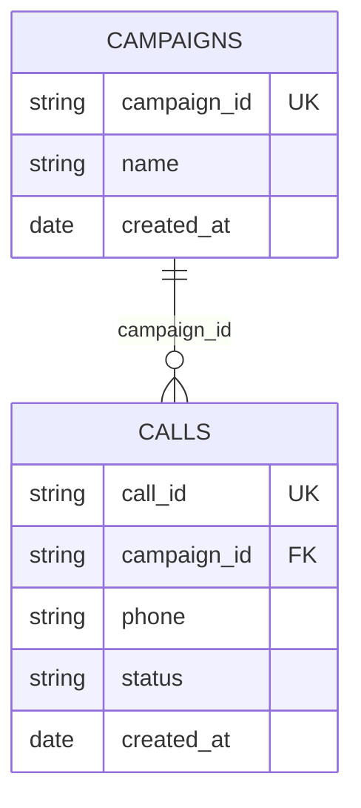
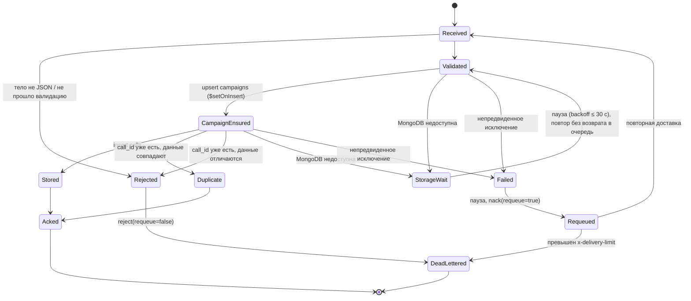
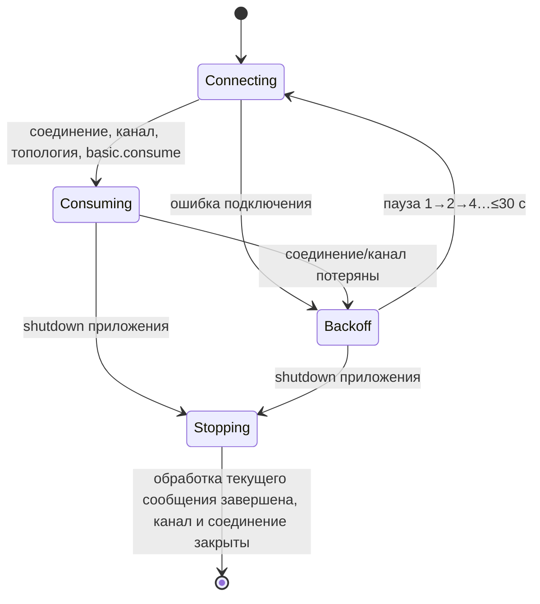

# Архитектура: call-results-service

Упрощённая модель интеграционного сервиса: результаты звонков приходят в RabbitMQ,
сервис сохраняет их в MongoDB и отдаёт через REST API.

## 1. Компоненты

```mermaid
flowchart LR
    P[producer.py<br/>отдельный скрипт] -- AMQP, publisher confirms --> X((exchange<br/>calls))
    X -- routing key<br/>call.result --> Q[[quorum queue<br/>calls.results]]
    Q -- reject / delivery-limit --> DLX((exchange<br/>calls.dlx))
    DLX --> DQ[[queue<br/>calls.results.dead]]

    subgraph APP[FastAPI-приложение, один процесс]
        C[CallConsumer<br/>фоновая asyncio-задача]
        S[CallIngestService]
        R[(Repository)]
        A[REST API<br/>/campaigns/&#123;id&#125;/calls<br/>/health]
    end

    Q -- consume, prefetch --> C
    C --> S --> R
    A --> R
    R <--> M[(MongoDB<br/>campaigns, calls)]
    U[Клиент] -- HTTP --> A
```



Консьюмер и HTTP-сервер живут в одном процессе и одном event loop: консьюмер
запускается в `lifespan` FastAPI как фоновая задача и останавливается при
завершении приложения.

## 2. Структура модулей

```
app/
  main.py          create_app(), lifespan: Mongo → индексы → консьюмер → API
  config.py        Settings (pydantic-settings, переменные окружения)
  log.py           настройка логирования (JSON-строки в stdout)
  models.py        доменные сущности Campaign, Call (frozen dataclasses)
  messaging.py     топология RabbitMQ (имена, аргументы очередей) - единый источник
  schemas.py       Pydantic-модели: входящее сообщение, ответы API
  repository.py    протоколы CampaignStore / CallStore и их MongoDB-реализации;
                   перевод временных ошибок PyMongo в StorageUnavailableError
  db.py            создание клиента MongoDB и индексов
  service.py       CallIngestService: бизнес-логика обработки одного сообщения
  consumer.py      CallConsumer: подключение, переподключение, ack/reject/nack
  api.py           HTTP-роуты
producer.py        отдельный скрипт-продюсер (самодостаточный, без импорта app)
tests/
  unit/            без внешних сервисов (in-memory двойники хранилища)
  integration/     реальные MongoDB и RabbitMQ (адреса из переменных окружения)
  e2e/             приложение целиком (lifespan) + producer.py - сценарий проверки
```

Зависимости направлены строго внутрь: `api`/`consumer` → `service` → `repository` →
`pymongo`. `service` не знает про AMQP, `consumer` не знает про MongoDB.

## 3. Модель данных (MongoDB)

### `campaigns`

| поле          | тип      | примечание                                  |
|---------------|----------|---------------------------------------------|
| `campaign_id` | string   | бизнес-ключ, **уникальный индекс**          |
| `name`        | string   | из сообщения (`campaign_name`)              |
| `created_at`  | date UTC | из `campaign_created_at` или время первого звонка кампании |

### `calls`

| поле          | тип      | примечание                                  |
|---------------|----------|---------------------------------------------|
| `call_id`     | string   | бизнес-ключ, **уникальный индекс**          |
| `campaign_id` | string   | ссылка на `campaigns.campaign_id`           |
| `phone`       | string   | только цифры, 10-15 знаков (E.164 без `+`)  |
| `status`      | string   | `[a-z][a-z0-9_]*`, до 32 символов           |
| `created_at`  | date UTC | время звонка из сообщения                   |

Индексы:

- `campaigns`: `{campaign_id: 1}` unique;
- `calls`: `{call_id: 1}` unique;
- `calls`: `{campaign_id: 1, created_at: 1, call_id: 1}` - покрывает выборку
  звонков кампании с сортировкой и пагинацией.

`_id` - ObjectId по умолчанию, наружу не отдаётся. Даты хранятся как BSON Date
(UTC), в API отдаются в ISO 8601 с `Z`.



## 4. Контракт сообщения

Очередь `calls.results`, тело - JSON в UTF-8, `content_type=application/json`.

```json
{
  "call_id": "call_0001",
  "campaign_id": "camp_001",
  "campaign_name": "Напоминание о платеже",
  "campaign_created_at": "2026-10-20T10:00:00Z",
  "phone": "79001234567",
  "status": "success",
  "created_at": "2026-10-20T10:06:00Z"
}
```

`campaign_created_at` - необязательное. Все даты обязаны содержать часовой пояс.
Неизвестные поля игнорируются (обратная совместимость с будущими версиями
продюсера).

## 5. Топология RabbitMQ

| объект                | тип              | параметры                                                        |
|-----------------------|------------------|------------------------------------------------------------------|
| `calls`               | exchange, direct | durable                                                          |
| `calls.results`       | queue, quorum    | durable, `x-dead-letter-exchange=calls.dlx`, `x-delivery-limit=5` |
| binding               | `calls` → `calls.results` | routing key `call.result`                               |
| `calls.dlx`           | exchange, fanout | durable                                                          |
| `calls.results.dead`  | queue, classic   | durable, привязана к `calls.dlx`                                 |

Продюсер и консьюмер объявляют основную очередь с одинаковыми аргументами,
поэтому порядок запуска не важен. Совпадение аргументов проверяется тестом.

## 6. Конечный автомат обработки сообщения



Правила:

1. `ack` отправляется **только** после успешной записи звонка в MongoDB
   (или после подтверждения, что ровно такой звонок уже записан).
2. Невалидные сообщения логируются (`WARNING`, с причиной и обрезанным телом) и
   отклоняются без возврата в очередь - RabbitMQ переносит их в
   `calls.results.dead`. Консьюмер продолжает работу.
3. Временная недоступность MongoDB (`ConnectionFailure`, таймауты, ошибки с
   меткой `RetryableWriteError` → `StorageUnavailableError`) - проблема не
   сообщения, а инфраструктуры. Консьюмер держит сообщение неподтверждённым и
   повторяет обработку на месте с экспоненциальной паузой (до 30 с). Счётчик
   доставок при этом не растёт, поэтому длительный простой БД не отправляет
   исправные сообщения в DLQ. Новые сообщения в это время не забираются.
4. Непредвиденное исключение (ошибка в коде, неожиданный ответ БД) логируется с
   трассировкой, сообщение после паузы возвращается в очередь
   (`nack(requeue=true)`). Quorum queue считает доставки; после
   `x-delivery-limit` сообщение уходит в DLQ, поэтому «ядовитое» сообщение не
   крутится бесконечно. Консьюмер не падает.

## 7. Жизненный цикл консьюмера



Если RabbitMQ недоступен при старте, приложение всё равно поднимается и отдаёт
API; консьюмер переподключается в фоне. Состояние видно в `GET /health`.

## 8. Конкурентность и согласованность

- **Внутри процесса** сообщения обрабатываются последовательно (`prefetch_count`
  задаёт только буфер). Это упрощает рассуждения и для объёма задачи достаточно;
  горизонтальное масштабирование - несколько реплик приложения на одну очередь.
- **Между репликами / при повторных доставках** корректность обеспечивается
  уникальными индексами и идемпотентными операциями, а не блокировками:
  - кампания создаётся `update_one(..., {"$setOnInsert": ...}, upsert=True)`;
    гонка двух upsert'ов может дать `DuplicateKeyError` - он означает, что
    кампания уже создана, и трактуется как успех;
  - звонок вставляется `insert_one`; `DuplicateKeyError` по `call_id` →
    сравниваем сохранённый документ с входящим: совпал - дубликат (ack),
    отличается - конфликт данных (reject в DLQ, `ERROR` в лог).
- **Атомарность «кампания + звонок»** не нужна: кампания создаётся первой и
  идемпотентно. Если запись звонка упала, повторная доставка просто найдёт
  кампанию. Транзакции MongoDB (требуют replica set) поэтому не используются.
- **Чтение API** не блокирует консьюмер: оба используют один пул соединений
  `AsyncMongoClient`.
- **Graceful shutdown**: при остановке приложение отменяет задачу консьюмера;
  сообщение, которое не успели подтвердить, RabbitMQ вернёт в очередь при
  закрытии канала (at-least-once), а идемпотентность записи делает повтор
  безопасным.

## 9. API

`GET /campaigns/{campaign_id}/calls?limit=100&offset=0`

- кампания есть → `200`, `CampaignCallsResponse`:
  `{"campaign_id": "...", "total": 2, "limit": 100, "offset": 0, "calls": [...]}`,
  звонки отсортированы по `created_at`, затем `call_id`; страница и `total`
  считаются одним aggregate-запросом (`$match` → `$sort` по индексу → `$facet`),
  поэтому не расходятся, если звонок записан между двумя запросами;
- кампании нет → `200`, `CampaignNotFoundResponse`: `{"detail": "Кампания не найдена"}`;
- некорректный `campaign_id`, `limit`, `offset` → `422`.

`GET /health` - проверка готовности: `200`, если MongoDB отвечает на `ping` и
консьюмер в состоянии `consuming`; иначе `503`. Тело в обоих случаях -
`HealthResponse` с состоянием каждого компонента. Этот же эндпоинт использует
healthcheck контейнера, поэтому статус `healthy` в `docker compose ps` означает,
что сервис готов принимать сообщения.

Обе схемы ответа описаны Pydantic-моделями и видны в `/docs`.
